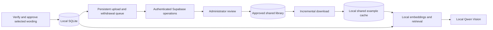

# Global RAG implementation handoff

Written 2026-10-24 against source commit `7e2c99a`.

**Status: design and implementation instructions only. Global synchronization is not implemented.** This document does not create a Supabase project, change the application, or authorize uploading existing receipts. Preserve the original four milestones in [PLAN.md](PLAN.md); this is a separate extension. Read [AGENTS.md](AGENTS.md) and [CONTEXT.md](CONTEXT.md) before starting.

## 1. Agreed outcome

Users should contribute verified examples to a shared Supabase library and receive examples contributed by others. Each PC must retain a persistent local copy of downloaded examples so receipt processing and RAG continue when the internet or Supabase is unavailable.

- Save local receipt edits, verification, and local examples before attempting network synchronization.
- Keep local private examples separate from shared examples. The existing checkbox, **Use this verified receipt and its corrections for future local suggestions**, must never become permission to upload.
- Add separate, explicit permission for global sharing and a preview of the exact shared content.
- Queue contributions durably; retry after outages and application restarts.
- Download changes and withdrawals into a local cache. Search locally during ordinary receipt processing.
- Keep PaddleOCR, Qwen Vision, and EmbeddingGemma inference local. Supabase stores and synchronizes approved data; no cloud AI or paid inference API is needed.
- Preserve receipt originals, manual edits, verified revisions, export snapshots, batch behavior, and the existing sequential model worker.
- Synchronization provides availability, but is not a backup: unwanted changes can propagate. Keep independent recoverable backups.

Recommended first rollout: one invitation-only shared library with administrator-reviewed contributions. Public registration, multiple organizations in the UI, and automatic approval are later work. These rollout defaults are recommendations, not features already accepted or implemented.

## 2. What exists today

| Existing code | Current responsibility / integration point |
| --- | --- |
| [backend/app/retrieval.py](backend/app/retrieval.py) | `eligible`, `evidence`, `receipt_text`, `Retrieval.index/search`; local model `embeddinggemma:300m-qat-q4_0`, 256 dimensions, maximum 10,000 indexed receipts, top five matches by default |
| [backend/app/vision.py](backend/app/vision.py) | `_example_context` sends up to three examples to Vision; excludes historical financial/date/code fields and treats examples as untrusted data |
| [backend/app/worker.py](backend/app/worker.py) | Queued indexing and vision; `process_vision` retrieves before inference; preserves intervening edits through revision checks |
| [backend/app/service.py](backend/app/service.py) | Verification queues local indexing when opted in; edits invalidate verification and delete the old local index |
| [backend/app/features.py](backend/app/features.py) | Suggestions, review options, verification-related eligibility changes, splitting, backups |
| [backend/app/main.py](backend/app/main.py) | Application lifecycle, loopback authentication, receipt deletion; enqueue withdrawal before deleting a shared source |
| [backend/app/db.py](backend/app/db.py) | SQLite schema v3, receipt snapshots and migrations; `retrieval_entries` has a receipt foreign key |
| [backend/app/backups.py](backend/app/backups.py) | Consistent workspace backup and staged restore; schema compatibility currently capped at v3 |
| [frontend/src/Review.tsx](frontend/src/Review.tsx) | Existing local-use checkbox and verification controls |
| [frontend/src/ReceiptAssistance.tsx](frontend/src/ReceiptAssistance.tsx) | Local example display, source links, explicit wording application |
| [frontend/src/WorkspaceSettings.tsx](frontend/src/WorkspaceSettings.tsx) | Add a Global library section with account, sync status, and controls |

The existing index contains wording, correction pairs, vectors, and source references. Receipt pictures are separate local files; they are not embedded image blobs in the RAG index. The workspace backup includes those files, but it is not a suitable global-library upload format.

Do not insert remote examples into existing `retrieval_entries`: its foreign key and eligibility purge require a local receipt. Do not create fake local receipts to satisfy those checks. Shared examples need their own cache and source citations.

## 3. Data boundaries and consent

Use three independent controls:

1. **Use this receipt locally**: existing per-receipt `retrieval_allowed`, unchanged.
2. **Use the shared library on this PC**: enables download, synchronization, and local retrieval from shared examples; contribution is not required.
3. **Share selected wording and corrections**: per-receipt approval of a previewed payload, bound to that exact verified revision and signed-in account/library.

For the initial implementation, only offer sharing for current, locally opted-in verified receipts. Turning local eligibility off must also withdraw a linked shared contribution. Downloading shared examples remains independent of sharing one's own receipts.

Define a dedicated allowlisted shared payload rather than uploading `receipt`, `data_json`, `evidence`, or a whole database:

- Optional vendor wording, explicitly selected in the preview.
- Selected item descriptions, units, and categories.
- Selected before/after correction pairs for vendor, description, or unit.
- Payload format version and opaque contribution ID.
- Operational metadata added by the server: library ID, publication version, status, timestamps, and authenticated ownership.

Exclude photos/crops, local paths, filenames, receipt numbers, purchase dates, quantities, prices, amounts, totals, free-form Notes, reviewer names, full OCR text, raw prompts, and model responses. Product codes and dimensions inside legitimate descriptions may remain; do not erase every digit. Wording can still contain sensitive information, so field selection, preview, length validation, and administrator review are required; do not claim the payload is automatically anonymous.

Use proposed bounds of 20 selected items, 20 correction pairs, and 32 KiB serialized JSON per contribution. Enforce them on both sides. These are v1 product limits to validate during implementation, not existing API limits.

Do not automatically upload previously verified/opted-in records. Selecting sharing on an already verified receipt queues a contribution after preview acceptance. Editing a shared receipt immediately disables its old local eligibility and queues withdrawal. Reverification does not silently publish changed wording: require approval of the new payload. Deletion, second review, splitting, and consent withdrawal must also retire the published version.

## 4. Architecture and ownership



SQLite remains authoritative for private receipts and pending user actions. Supabase is authoritative for shared publication versions, moderation, and withdrawals. Each PC caches shared text and creates its own rebuildable embeddings using the pinned local model. For v1, store shared text in Supabase; server-side embeddings/pgvector search are unnecessary for this sync-and-search-locally design.

Implement network synchronization outside the heavy inference worker. A single bounded background sync loop is sufficient; it must not invoke Ollama directly. Queue shared embedding work onto the existing model worker so OCR, Vision, and embeddings never run concurrently. A sync failure must not block verification, review, upload, or export.

## 5. Proposed persistent state

These are implementation targets, not an applied schema. Prefer small tables and explicit migrations over a generic replication framework.

### Local SQLite additions

| State | Required content |
| --- | --- |
| Sharing records | Local receipt ID, account/library, opaque contribution ID, approved source revision and payload hash, latest acknowledged remote version, sharing status |
| Sync outbox | Stable operation UUID, contribution ID, account/library, operation (`submit`/`withdraw`), approved revision/hash, immutable selected payload when needed, expected remote version, retry count, next attempt, last error |
| Shared cache | Library/contribution IDs, remote version and change cursor, approved payload/hash, active/withdrawn state, received timestamp; optional local embedding plus exact model/version/dimensions |
| Sync checkpoint | Account/library scope, server epoch, last applied cursor, last success, latest error |

Outbox withdrawal records must survive source receipt deletion: do not cascade-delete them with receipts. Write receipt changes, local invalidation, and related outbox operations in one short SQLite transaction. Never hold that transaction during HTTP requests or inference.

### Supabase Postgres additions

Start with membership/roles, current contribution state, idempotency receipts, and one library state row. Use UUIDs for identities, `bigint` for versions/cursors, `timestamptz` for server timestamps, `jsonb` for the bounded validated wording payload, and constraints for statuses and uniqueness.

- Membership: library, authenticated user, role (`member`/`moderator`). Only a trusted administrator grants membership or roles.
- Contribution: library/ID, owner, selected payload, server-computed hash, version, status (`pending`, `published`, `rejected`, `withdrawn`), and published-feed change cursor.
- Idempotency receipt: actor plus operation UUID, request hash, and result. Reusing a UUID for a different request must fail.
- Library state: epoch and transactional change counter. Serialize feed-visible publication/withdrawal changes using this row's lock and increment the counter inside the same transaction.

Index membership lookups, ownership queries, foreign-key access paths, and `(library_id, change_cursor)`. A bare sequence allocated before commit is not a safe feed watermark: transactions can commit out of order. Publication, withdrawal, version increment, and change-counter increment must be atomic. Keep these transactions short.

Keep tombstones (IDs, versions, withdrawal status, cursor) available to clients even after removing the payload. A normal query that only returns published rows cannot tell a disconnected client what to delete. Rejected/unpublished contributions and their contents must not appear in other members' feeds. If tombstones are eventually compacted, change the library epoch and require a complete cache reconciliation.

## 6. Supabase setup and access controls

1. Create a development Supabase project using synthetic examples. Record the project URL and publishable key in configuration; neither is an administrator credential. Do not provision or seed production data while writing this plan.
2. Configure Supabase Auth and one invitation-only library. Existing Reviewed by labels are not accounts. For desktop sign-in, implement the provider's supported PKCE flow with state validation and exact callback allowlisting. Choose/configure the provider before implementing its callback; public email signup needs appropriate SMTP configuration.
3. Store refresh credentials with Windows Credential Manager or Windows DPAPI protection outside the transferable workspace. Do not put tokens in frontend localStorage, logs, `.env` committed to Git, exports, or backups. Require sign-in again after restore to another PC.
4. Add versioned Supabase SQL migrations under a new `supabase/migrations/` directory. Enable RLS on every exposed table and test access using actual authenticated roles.
5. Members may submit their own pending examples and withdraw their own contributions. They may read their own moderation state and the published feed for their library. They cannot read other members' pending payloads, approve submissions, edit somebody else's contribution, change owners, or grant roles.
6. Restrict mutation to validated server operations. Do not rely on client-provided owner IDs, verification flags, hashes, roles, publication status, or timestamps. Moderator approval is distinct from the contributor's local verification.
7. Never ship a Supabase secret/service-role key in the executable or browser. If elevated RPC functions are needed, authorize `auth.uid()` and membership inside each function, fix `search_path`, qualify objects, and restrict execution grants. Test definer functions specifically; RLS alone does not make an elevated function safe.
8. Apply request/payload limits and contribution quotas. Validate retrieved text as data; no fetched instructions, HTML, executable content, or URLs may control application behavior.

Use HTTPS to the configured project only. Keep external sync traffic isolated from the loopback-only OCR/Vision adapters. With global mode disabled, normal operations must make no Supabase requests.

## 7. Synchronization contract

Implement proposed server operations with these semantics; names may be adjusted to fit the final API:

- `submit_example(operation_id, contribution_id, expected_version, payload)`: authenticated owner; validate and recompute hash; return a stable result for retries; create/update pending state. A replacement requires fresh moderation and retires any previously published content.
- `withdraw_example(operation_id, contribution_id, expected_version)`: authenticated owner or moderator; atomically publish a tombstone for previously shared content. A stale submit cannot resurrect a withdrawn version.
- `review_example(contribution_id, expected_version, decision)`: moderator only; approve/reject one exact version.
- `list_changes(epoch, after_cursor, limit)`: authorized library members; return published changes and withdrawals in ascending commit-ordered cursor order, with an explicit continuation cursor and bounded page size. Never include private pending payloads.

Client algorithm:

1. Commit local work and outbox entry, then immediately return control to the user.
2. Recheck live source eligibility, sharing consent, approved revision/hash, and account/library before every submission attempt. Drop obsolete submissions; prioritize withdrawal over older submissions for the same contribution.
3. Send a stable operation UUID. A timeout after the server committed is retried with the same UUID; no duplicate example may result. On a version conflict, fetch remote state and reconcile; do not blindly overwrite it. A pending withdrawal must be retried against current remote state until acknowledged or access is explicitly blocked.
4. Download pages of at most 100 changes with a proposed 1 MiB decoded response cap. Apply the page and its cursor in one local transaction. Advance only after successful validation/application. Invalid data stops cursor advancement and produces an actionable error.
5. Cache newer versions only; ignore duplicate/older responses. Remove withdrawn payloads and vectors immediately upon receiving their tombstones. Queue embeddings only for new/changed active text.
6. On epoch change, build a replacement snapshot and reconcile missing IDs; never interpret an empty response caused by an error as an empty library. Suspend use of known-obsolete cached records until reconciliation completes.
7. Retry transient failures with bounded exponential backoff and jitter; suggested delays: 5 seconds, 30 seconds, 2 minutes, 10 minutes. Respect `Retry-After`; refresh authentication once on expiry, then request sign-in. Use bounded network timeouts and cancellation.
8. Sync on explicit **Sync now**, sign-in, contribution changes, and a modest interval while the app is open (initially five minutes). Avoid per-receipt full-library downloads or a new WebSocket service for v1.

Cached approved examples remain available offline with a last-sync timestamp. New shared data and withdrawals cannot arrive while disconnected. Do not promise immediate global erasure or revocation of previously downloaded copies. On explicit sign-out, account/library switch, or a confirmed authorization denial, disable that shared cache and purge it according to the account policy; an ordinary timeout must not be mistaken for revoked access.

## 8. Retrieval behavior and the fresh-upload limitation

Extend the local search result format with source kind (`local`/`shared`), contribution ID, version, library, and citation. Preserve local revision/consent checks. Filter withdrawn/stale shared entries, exclude the target receipt's own linked contribution, deduplicate equivalent examples, and prefer local verified wording when scores tie. Keep the Vision context capped at three examples and the current numeric/date exclusion rules.

Display a shared-source citation instead of trying to open a nonexistent local receipt. Applying suggested wording remains explicit; upload Vision keeps its existing revision-guarded automatic application behavior. Remote synchronization alone must never edit a receipt.

For v1, retain a bounded local search pool. The current scanner caps at 10,000 entries: define and test a combined local/shared budget without silently deleting private examples. Show an incomplete-cache notice if the library exceeds the supported limit. Start with a capped pilot library; broader partial-download policies or an ANN index require measured need.

**Current issue:** `Worker.process_vision()` searches before the first vision pass using saved receipt wording. New uploads often have empty fields because automatic OCR is off. A generic `Vendor:` query is not meaningful evidence for matching.

Implement this deliberately:

1. Skip retrieval when there is no meaningful vendor/item wording.
2. After the initial reading, use the extracted wording to populate local/shared suggestions.
3. A subsequent user-requested **Run Vision** can use those meaningful fields and relevant examples. Do not silently add a second expensive vision pass to every upload.
4. Calibrate a minimum similarity threshold on held-out receipts; return no examples when no useful match exists. Do not present similarity as extraction confidence.

If automatic first-upload refinement is desired later, make it an explicitly chosen, bounded second-pass policy and benchmark latency, memory, and quality. More shared receipts alone do not prove better handwriting recognition.

## 9. Implement in completed slices

- [ ] **GR1 — Local state and migrations.** Add cache, sharing records, outbox, and checkpoints; retain existing local RAG behavior. Back up schema v3 before migration. Update `Store` version checks/migrations and `backups.MAX_SCHEMA` together; preserve rollback snapshots. No network required for this slice.
- [ ] **GR2 — Remote contract and auth.** Implement migrations, RLS, membership, moderation, idempotency, versions, and the changes API in a disposable Supabase project. Prove permissions with two users and one moderator before using real examples.
- [ ] **GR3 — Reliable sync.** Add a small module such as `backend/app/rag_sync.py` for the network client/loop. Wire lifecycle into `main.py`, receipt transitions into `service.py`/`features.py`/deletion, and durable embedding jobs into `worker.py`. Reuse existing HTTP and SQLite patterns; avoid a generic sync framework.
- [ ] **GR4 — Local retrieval and UI.** Extend `retrieval.py`, `ReceiptAssistance.tsx`, `Review.tsx`, and `WorkspaceSettings.tsx`. Add contribution preview, independent consent controls, source/version labels, pending upload count, indexing state, last sync, Sync now, and understandable offline/auth/quota errors. Implement the fresh-upload behavior above.
- [ ] **GR5 — Recovery and pilot.** Test two Windows installations, interrupted networking, backup/restore, server pause, account changes, and an application update. Add operational instructions to README/CONTEXT after implementation, without rewriting PLAN.md's original milestones. Commit meaningful slices and push to the configured origin.

Recheck the working tree before each slice. The current repository contains unrelated uncommitted review-control/documentation changes; do not stage everything or assume those changes belong to this work. Use synthetic workspaces, not `artifacts/dev-workspace`, for mutating tests.

## 10. Acceptance tests and validation commands

Add focused tests such as `backend/tests/test_global_rag.py` and role-based Supabase integration tests. Required evidence:

- Local-only opt-in never uploads; unverified/stale/unapproved revisions never submit. Download-only use works.
- Checking sharing on an already verified receipt queues the approved payload; disabling it withdraws the contribution.
- Missing image/financial fields are enforced server-side; malformed/oversized payloads are rejected; no token or private path appears in logs or backups.
- User A cannot mutate B's examples, read B's pending payload, self-approve, or grant membership. Outsiders cannot read the library. Moderators can review only their library.
- Lost acknowledgments, duplicate operations, crashes, and repeated syncs do not duplicate records. Source edits or deletion during an in-flight upload eventually withdraw the stale publication.
- Receipt deletion does not delete its pending withdrawal. Old queued submits cannot resurrect withdrawn data. Conflicts after restoring/cloning a workspace require reconciliation, not last-writer-wins resurrection.
- Pagination and concurrent publish/withdraw commits cannot skip an event. Cache writes and cursor updates roll back together. A malformed page cannot advance the cursor. Epoch changes reconcile the full state.
- A timeout, paused Supabase project, quota restriction, or expired login preserves local receipt processing and already valid offline examples. Confirmed membership revocation disables that account's cache.
- Shared embeddings obey the single-worker model constraint, carry exact model identity/dimensions, and rebuild after incompatibility. Missing models do not lose cached text or block export.
- Retrieval excludes the target's own contribution, handles remote citations, applies no historical financial facts, and makes no remote query during offline search.
- Migration and backup/restore preserve receipts, photos, edits, verification and export history, cache, and outbox. Restored clients reauthenticate and reconcile before sending old operations; deleted/withdrawn server entries stay retired.
- Two-device demonstration: A verifies and shares; moderator approves; B syncs and retrieves offline; A withdraws; B removes it after reconnecting. Measure sync bytes and run a held-out handwriting evaluation before claiming quality gains.

Run from the repository root after implementation:

```powershell
.\.venv\Scripts\python.exe -m pytest backend/tests -q
.\.venv\Scripts\ruff.exe check backend
npm --prefix frontend run build
node frontend/tests/amount.mjs
node frontend/tests/amountCompletion.mjs
node frontend/tests/purchaseDate.mjs
node frontend/tests/receiptDays.mjs
git diff --check
```

Also run the new auth/RLS and two-device tests against the isolated test service. Configure tests so ordinary local receipt operations still pass with external network access blocked. Never point destructive integration tests at a production Supabase project. These are future acceptance instructions, not a claim those tests exist or passed today.

## 11. Backups, free-tier operation, and recovery

Keep local workspace backups and independent shared-database exports. Local sync is not an administrator backup of every user's shared contributions. Do not upload ReceiptIQ workspace backup ZIPs to the shared library.

Before restoring an old shared-server backup, rotate the library epoch and reconcile clients. Preserve withdrawal tombstones separately or require moderator review of recovered publications: a rollback must not silently republish withdrawn wording. Document a tested recovery procedure rather than treating client caches as an automatic server-restore authority.

Supabase Free limits checked on 2026-10-24: 500 MB database per project, 5 GB monthly ordinary egress, separate 5 GB cached egress, 1 GB file storage, and 50,000 monthly active auth users. Free projects may pause after insufficient activity over seven days; the documented paused-project recovery window is currently one year. Automatic database backups are not included. Recheck all policies before rollout.

For this design, ordinary database downloads count toward the 5 GB egress budget; do not add cached egress to it. Share text, sync deltas, measure actual bytes, and reserve database space for metadata/indexes. Earlier estimates of 5–10 KB per compact example and a 20–100-user pilot were planning assumptions, not measured capacity. Keep images local and avoid a global-library dependency for normal offline work.

Sources to recheck:

- [Supabase pricing](https://supabase.com/pricing)
- [Billing quotas](https://supabase.com/docs/guides/platform/billing-on-supabase)
- [Egress accounting](https://supabase.com/docs/guides/platform/manage-your-usage/egress)
- [Project pausing and restoration](https://supabase.com/docs/guides/platform/free-project-pausing)
- [Authentication](https://supabase.com/docs/guides/auth)
- [Custom SMTP](https://supabase.com/docs/guides/auth/auth-smtp)
- [Row Level Security](https://supabase.com/docs/guides/database/postgres/row-level-security)

## 12. Resume prompt

> Implement the next unchecked slice in Global-rag-implemet.md. Read AGENTS.md and CONTEXT.md first, inspect current changes, and preserve unrelated work. Keep private receipt processing offline and local; implement global sharing only behind separate explicit consent. Start with synthetic data and the documented acceptance tests. Back up before migrations. Never upload existing receipts automatically or put a service-role key in the client. Stop after the slice is implemented, validated, documented, committed, and pushed; report remaining slices and any unverified deployment requirements.
