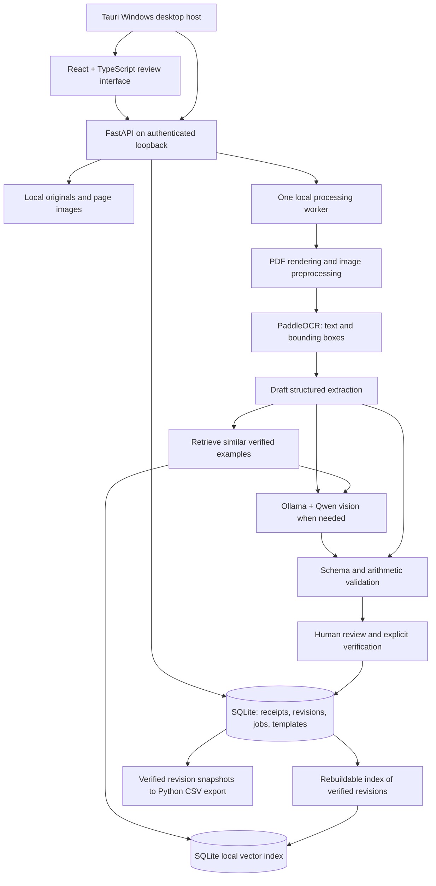

# ReceiptIQ implementation plan

Status: application code for all four milestones is implemented in version 0.4.0. Subsequent user-requested changes automatically queue and apply upload vision to unchanged, unverified receipts. This document retains the original milestone design and gates; see [CONTEXT.md](CONTEXT.md) for current behavior where that design has been superseded. Windows distribution is an unsigned preview pending publisher credentials and clean-machine release testing; implementation does not mean every release gate below has passed. See README.md for operation and VALIDATION.md for executed evidence and untested gates. Initial target: Windows 11 x64, one local workspace per Windows user. Reviewer names support shared-computer handoff; they are labels, not authenticated accounts.

Primary workload: users select or drag in tens of receipt images at once. Multi-image ingestion and durable batch processing are milestone 1 requirements. Design and test for batches of 20-100 images initially; this is a workload target, not a promised throughput or fixed file-count limit. Default to one receipt per image; photos containing several separate receipts require a later splitting/cropping workflow.

**Architecture and processing flow**

Use a modular monolith: React + TypeScript + Vite for the interface, FastAPI for application logic, SQLite for authoritative records, and one local processing worker. Tauri becomes the desktop host in milestone 4. Avoid Redis, Celery, Docker, cloud services, and a separate vector database server for the initial release.



SQLite is the source of truth; the local vector table is rebuildable. The implementation uses a bounded cosine scan of up to 10,000 256-dimensional entries, avoiding a second database dependency. A failed indexing operation never loses a verified receipt or blocks CSV export. Vision produces a separate candidate and requires explicit application; it never automatically overwrites a draft.

Accept a multi-file selection as one logical batch, but transfer files individually with bounded upload concurrency and per-file acknowledgments. Persist each accepted original and its queued job before acknowledging success. Start processing as files arrive; do not wait for the entire batch. Decode only the active document/pages and load preview thumbnails on demand rather than retaining every full-resolution image in RAM. One heavy processing task runs at a time initially, keeping the interface and review API responsive. A corrupt image fails independently without blocking other receipts.

Show separate counts for uploading, queued, processing, ready for review, verified, and failed. Users can review completed receipts while later receipts process and export the verified subset without waiting for the batch. Clearly identify unfinished or unverified receipts excluded from an export. Restart resumes accepted files and interrupted jobs; files not yet transferred may require reselection, which the UI must explain.

Preserve original files. Render PDFs with pypdfium2 and preprocess working copies with Pillow/OpenCV: EXIF rotation, deskew, bounded resizing, and conservative contrast adjustment. Keep coordinate transforms so selecting an extracted field highlights the right region in the original. Start with one receipt per uploaded document, including multi-page receipts; milestone 3 adds manual page grouping/splitting for PDFs containing several receipts.

PaddleOCR provides text, coordinates, and OCR scores. A deterministic parser produces the initial structure; unclear values stay null with warnings. Vision adds candidates for difficult crops or page layouts. RAG uses reliable OCR fragments, supplier context, and locally embedded verified examples to retrieve suggestions before optional vision re-interpretation. Never substitute historical prices or totals as facts about a new receipt. Retrieval improves available context; it does not retrain model weights.

Store raw extraction separately from editable values. Track field source, page/region, OCR score if available, and validation issues. Do not present a model's self-reported certainty as a calibrated probability. Receipt text and retrieved text are data, never executable instructions or tools.

**Hardware and offline operation**

Use CPU PaddleOCR initially to simplify Windows distribution and leave GPU memory available for vision. PaddlePaddle documents separate CPU and GPU packages; GPU OCR can be added only if profiling justifies another runtime variant. [Official installation documentation](https://www.paddleocr.ai/main/en/version3.x/paddlepaddle_installation.html).

Benchmark `qwen3-vl:2b-instruct` as the low-resource candidate and `qwen3-vl:4b-instruct` as the higher-quality candidate. These are available vision models, not a promise that either will read all handwriting accurately. The official model pages list an Ollama minimum of 0.12.7; pin and test the actual runtime/model pair at implementation. [2B model](https://ollama.com/library/qwen3-vl:2b-instruct), [4B model](https://ollama.com/library/qwen3-vl:4b-instruct).

On the stated RTX 3060 laptop and 16 GB RAM, evaluate candidates with one vision request at a time. The implemented probe reads CPU identity/count, installed RAM, GPU/total VRAM/driver, and free workspace disk. It does not promise free-VRAM headroom, CPU instruction compatibility, or successful inference from these values alone. The actual 15.7 GB RAM/6 GB VRAM probe conservatively recommends 2B; that profile has run real local inference. CPU-only machines retain OCR/manual-review/export. Separate CPU vision, 4B quality, peak GPU memory, and measured minimum hardware remain unvalidated release checks.

Workspace settings inventories hardware, recommends a capacity profile, shows download sizes and disk requirements, and installs assets with persistent progress/retry. Ollama 0.40.6 is SHA-256 verified; only local Qwen3-VL 2B/4B instruct and embeddinggemma:300m-qat-q4_0 tags are allowed. Setup confirms installed model tags and asks users to run a sample; it does not establish inference capacity by downloading alone. Cache OCR, vision, and embeddings explicitly. Normal processing uses no cloud fallback; real evaluations block non-loopback sockets. Setup/downloads require internet.

**Database schema**

IDs are UUID strings; timestamps are UTC. Use foreign keys, transactions, and numbered migrations. Represent money and quantities as decimal strings parsed with Python Decimal, never binary floats. Store currency separately and do not invent a currency, date, or missing amount.

| Table | Main columns and purpose | Introduced |
|---|---|---|
| `documents` | `id`, original name/path, SHA-256, MIME type, timestamp; immutable source file | M1 |
| `document_pages` | `id`, `receipt_id FK`, page number, original/processed paths, width/height, transform JSON | M1 |
| `receipts` | IDs for document/batch/upload; status, revision, verified_revision, header `data_json`, field metadata, rotation, error, timestamps; assignee, second_review, retrieval_allowed | M1; M3 flags |
| `receipt_items` | `receipt_id FK`, position, `data_json` containing stable item ID, wording, quantities, decimal prices/Amount, optional photo | M1 |
| `extraction_runs` | ID, receipt FK, engine, immutable result JSON, timestamp; OCR evidence and independent revision-bound vision proposals | M1/M2 |
| `review_events` | ID, receipt FK/revision, action, before/after JSON, reviewer label, reason, timestamp; verification snapshots | M1 |
| `jobs` | ID, receipt/batch FKs, kind, state, stage, progress, attempts, error, timestamps, payload JSON | M1; M2/M3 kinds |
| `csv_templates` | ID, version, definition JSON with name, row mode, ordered mappings and format/required-field options | M1 default; M3 editor |
| `export_queue` | `receipt_id FK`, `verified_revision`, added time; only eligible verified revisions | M1 |
| `exports` | `id`, template snapshot JSON, local file path, created time | M1 |
| `export_receipts` | `export_id FK`, `receipt_id FK`, verified revision, data snapshot JSON; reproducible export history | M1 |
| `batches` | `id`, name, expected file count, upload state, created time; receipt/job states determine review and processing progress | M1 |
| `batch_files` | client upload ID primary key, batch FK, original name, state/error, receipt ID; unique receipts.upload_id makes retries idempotent | M1 |
| `attachments` | ID, receipt FK, relative path, original name, MIME, timestamp; owned receipt/item photos | M1 follow-up |
| `line_item_numbers` | autoincrement number, receipt FK, unique item ID | M1 follow-up |
| `retrieval_entries` | receipt FK primary key, verified revision, embedding model, text, vector JSON, indexed timestamp | M3 |

These are the implemented schema-v3 tables; backend/app/db.py owns exact SQL. Reviewer names remain plain local labels. Header/item values and evidence use JSON; money remains decimal strings. No separate receipt_pages, reviewer-account table, or Chroma server is needed.

Implemented expense follow-up: schema v2 adds attachments (owned receipt/item photos) and line_item_numbers (persistent item UUID to local number). Editable header/item values use JSON in receipts and receipt_items; Notes, Unit, Type, and photo references are included. Legacy Tax/Subtotal/Discount values remain stored but are absent from the form and CSV. PHP is the explicit initial workplace default. Migration creates a consistent pre-v2 database backup and retains existing verification revisions and export files.

Receipt states: `queued -> processing -> needs_review -> verified`, plus `failed`, `cancelled`, and retained `split` originals. Second review is a separate flag, not a new status. Editing a verified receipt increments its revision, clears current verification, and removes pending export/retrieval eligibility. Previously generated export snapshots remain unchanged.

Verification and opt-in indexing jobs commit together. Retrieval checks current SQLite verification/revision and opt-in on every hit. Edited, deleted, opted-out, or second-review sources cannot remain eligible through stale vectors. Rebuild the index from current opted-in verified data after an embedding change; failed index work never blocks export.

**Implemented folder structure**

```text
receiptiq/
  frontend/
    src/
      App.tsx, Review.tsx, ReceiptAssistance.tsx
      WorkspaceSettings.tsx, TemplatesEditor.tsx
      api.ts, types.ts, style.css, settings.css, assistance.css
    package.json
  backend/
    app/
      main.py
      main.py, features.py, models.py   # Routes, boundaries and schemas
      db.py, service.py, transfer.py    # Storage, review, export and imports
      worker.py, imaging.py, ocr.py, extraction.py
      vision.py, retrieval.py, templates.py
      system.py, backups.py            # Setup and workspace lifecycle
    tests/
    pyproject.toml
  src-tauri/               # Rust host, lifecycle, NSIS installer
  packaging/               # Runtime manifest and Python bundle configuration
  scripts/                 # Setup, build, evaluations and smoke checks
  artifacts/               # Ignored synthetic evidence, screenshots and bundles
```

Keep this modular monolith until real module size warrants subpackages. Project root is C:\Users\ruthl\Desktop\Codink\ReceiptIQ, separate from the adjacent Frutiger Aero application.

Runtime data lives outside the installation directory, under `%LOCALAPPDATA%\ReceiptIQ\`: SQLite/vectors, originals, pages, attachments, model/runtime caches, exports, backups, and setup state. Storage moves are staged, applied offline, and retain the source. Never place user receipts in the repository or installer assets. Local storage is not encrypted; use OS protections and make no encryption claim.

**API design**

Prefix endpoints with `/api/v1`. React uses HTTP; desktop startup supplies a per-launch secret and an available loopback port. FastAPI binds only to `127.0.0.1`, validates the secret and allowed origins/hosts, and exposes only scoped files by ID. Request handling remains responsive while one worker performs expensive processing. Poll job status initially.

| Method and path | Contract |
|---|---|
| `GET /health` | Readiness and component availability |
| `POST /batches` | M1: create a batch and file manifest; return batch ID and stable per-file upload IDs |
| `POST /receipts` | M1: upload one selected file per request with batch/upload IDs; stream to disk, enforce file/page/pixel limits, persist accepted work, and return receipt/document/job IDs with `202`; retrying the same upload ID returns the existing result |
| `GET /batches/{id}` | M1: per-file upload outcomes and aggregated processing/review counts; paginate receipt details |
| `POST /batches/{id}/retry-failed` | M1: retry failed processing jobs without duplicating accepted receipts; untransferred files are reselected/reuploaded separately |
| `POST /batches/{id}/cancel` | M1: stop pending work and cancel active processing at safe boundaries; preserve accepted originals and completed review work |
| `GET /receipts` | Paginated queue; filters for status, supplier, assignee, batch |
| `GET /receipts/{id}` | Fields, items, evidence references, warnings, revision, verification state |
| `GET /receipts/{id}/pages/{page_id}` | Authorized original/processed page view |
| `PATCH /receipts/{id}` | Save editable fields/items plus expected revision; return `409` on stale edits |
| `POST /receipts/{id}/validate` | Return required-field, numeric, date, and total reconciliation issues |
| `POST /receipts/{id}/verify` | Revalidate expected revision; record reviewer, snapshot, and acknowledgments; enqueue verified revision |
| `POST /receipts/{id}/process` | Retry/rotate OCR; preserve manual corrections |
| `POST /receipts/{id}/vision` | Revision, page ID, optional normalized crop and allowlisted model; durable proposal job |
| `POST /receipts/{id}/candidates/{candidate_id}/apply` | Explicitly apply a proposal only at its original expected revision |
| `GET /jobs/{id}` | State, stage, progress, actionable failure |
| `POST /jobs/{id}/cancel` | Safe cancellation at processing boundaries |
| `GET, POST /templates` / `GET, PATCH, DELETE /templates/{id}` | Versioned formats; built-in expense template immutable |
| `GET /export-queue` | Eligible verified revisions |
| `POST /exports/preview` | Validate selection and show mapped rows |
| `POST /exports` | Generate from verified revision snapshots and chosen template; return export ID |
| `GET /exports/{id}/download` | Download generated CSV |
| `GET /receipts/{id}/suggestions` | M3: examples, candidate interpretations, and source receipt references |
| `POST /receipts/{id}/review-options` | Revision-safe reviewer, second-review and retrieval opt-in |
| `POST /receipts/{id}/split` | Partition all original PDF pages once; preserve split source |
| `GET /system/capabilities` / `GET /setup/status` | M4: hardware, runtime, model, and setup readiness |
| `POST /setup/install` | M4: install a supported runtime/model profile as a resumable job |
| `POST /system/location` | Stage an empty local target; copy/verify on restart before switching |
| `POST /backups` / `POST /backups/restore` | M4: consistent local snapshot and validated restore |
| `GET /backups` / `GET /backups/{name}/download` | List/download completed workspace archives |
| `DELETE /receipts/{id}` | Remove receipt and schedule associated data cleanup |

Validation distinguishes blockers from reviewable warnings. Invalid numeric values and missing template-required fields block verification/export. An ambiguous date or total mismatch requires correction or a recorded human resolution where allowed. No auto-approval by OCR score. Treat unavailable values as blanks, not zero.

Default CSV: one row per receipt item, repeating Vendor/Purchase date/Receipt ID. The expense format requires at least one line item; it uses the supplied form's wording and omits Tax/Subtotal/Discount columns. Receipt number joins distinct labeled codes with " / ". Optional item photos and receipt images travel in a ZIP alongside CSV with relative image paths. Import creates unverified review drafts. Total differences require human review; confirmed implicit discounts can be allocated explicitly across Amount and Unit price. M3 adds one-row-per-receipt templates, renamed/reordered columns, constants, required fields, delimiter, encoding, and date/decimal formats. Template mappings use an allowlist, not executable expressions. Handle quotes/newlines with Python csv; protect spreadsheet-facing text cells from formula injection while retaining valid numeric negatives.

**Milestone 1 — Working OCR, review, and CSV MVP**

Expense transfer API additions in milestone 1:

| Method and path | Contract |
|---|---|
| POST /imports | CSV plus selected photos, or a CSV/image ZIP; atomic import into unverified drafts and preview-only jobs |
| POST /receipts/{id}/photos | Validate and store an owned JPG/PNG; return attachment ID for the revision-safe draft save |
| GET /receipts/{id}/photos/{photo_id} | Serve only an attachment owned by this receipt |
| POST /receipts/{id}/discount-preview | Expected revision plus proposed fields; return proportional net Amount/Unit price adjustments without saving |
| POST /exports | Optional include_photos selects ZIP with CSV and relative images; otherwise ordinary CSV |

- Build the React/FastAPI application and initial SQLite migrations.
- Select or drag in tens of JPG/PNG receipt images at once, with PDF support retained. Upload files incrementally into a persistent batch; preserve originals and preprocess pages.
- Run CPU PaddleOCR and conservative structured parsing for supplier, date, receipt number, items, quantities, prices, and totals.
- Display receipt and editable data side by side, with zoom, rotation, field-to-image highlighting, autosaved drafts, and visible validation issues.
- Implement explicit verification, audit records, export queue, fixed CSV template, preview, and download.
- Add a durable batch queue with one active processing job, per-receipt status, aggregate progress, cancellation, retry-failed-only, and restart recovery. One failed image must not stop the batch.
- Support reviewing finished receipts while the batch continues and exporting selected verified receipts into one CSV. Display unfinished/excluded counts before export.
- Perform a small Python/PaddleOCR bundle feasibility check early; full desktop packaging stays in M4.

Completion gate: complete upload -> OCR -> correction -> verification -> CSV -> restart/reopen on representative printed, handwritten, and mixed samples. Handwriting may require full manual entry at this stage. Verify exact Decimal arithmetic and CSV round trips, including Unicode, commas, multiline descriptions, missing values, and formula-like text. The API must reject unverified and stale revisions. Confirm a packaged OCR smoke test works without a system Python installation.

Batch completion gate: select 50 real-resolution receipt images in one action, review early results while processing continues, and export a verified subset. Include a corrupt file and a repeated upload request, then restart midway; accepted files and edits must survive without duplicate receipts. Exercise a 100-image stress batch, measure peak memory and throughput, and confirm image decoding stays bounded to active work. Show honest per-file failures and distinguish incomplete uploads from interrupted processing. Performance limits will be documented from measurements on CPU-only hardware and the development laptop.

Establish a labeled evaluation set, targeting at least 60 consented/synthetic receipts split across printed, handwritten, and mixed inputs. Track normalized field accuracy, line-item extraction quality, total/date errors, correction time, processing time, and peak memory. Use a held-out subset excluded from retrieval. Record a baseline before promising accuracy percentages.

**Milestone 2 — Local vision and better extraction**

- Integrate Ollama with a tested Qwen vision profile.
- Add “Read this region again” and “Use vision” actions; automatically suggest vision for failed parsing or inconsistent fields.
- Pass source crops, OCR evidence, and a strict output schema. Validate output and keep alternative candidates for review.
- Support timeouts, out-of-memory fallback, bounded image/context sizes, and OCR-only recovery.
- Preserve human edits during reprocessing and show source/model provenance.

Completion gate: compare OCR-only and OCR-plus-vision on the held-out corpus. Enable automatic fallback only where results improve accuracy or correction time without increasing accepted errors; otherwise leave vision user-triggered. Record CPU and GPU latency/memory. Invalid JSON, missing Ollama, unavailable models, and memory failures must leave receipts editable and exportable after manual verification.

**Milestone 3 — Verified-example retrieval, batch work, and review QOL**

- Persist local vectors in SQLite and explicitly download the allowlisted EmbeddingGemma model. This meets the original Chroma-or-another-local-vector-store requirement without another runtime dependency. The scan is bounded to 10,000 eligible entries; measure before replacing it with a dedicated index.
- Index only current, explicitly opted-in verified supplier/item examples and human-approved wording corrections. Rank vendor/item/correction text by cosine similarity; show the supporting original example and require acceptance. Explicit supplier/category filters are deferred; current ranking includes that context in text.
- Extend the milestone 1 batch workflow with cross-batch exact-file duplicate warnings, review-priority filters, and manual PDF page grouping/splitting.
- Retain bounded processing and concurrent human review as vision and retrieval join the batch pipeline; increase processing concurrency only if measured memory and responsiveness permit it.
- Add local reviewer assignment, “needs second review,” notes, filters, and keyboard actions for save/next/next uncertain field. Provide undo for edits and an explicit “verified for future suggestions” control.
- Add customizable CSV templates and saved workplace formats.

Implemented in 0.4.0: these review tools, persistent vectors, and template options are present. Retrieval remains advisory; the small synthetic held-out evaluation is documented in VALIDATION.md. No cross-computer sharing or model fine-tuning is implied.

Completion gate: process a 50-document test batch; stop/restart midway without losing edits or duplicating receipts/exports. Confirm unverified, deleted, excluded, or superseded examples cannot appear in retrieval. Test on held-out receipts so an input cannot retrieve itself. Show measured retrieval benefit; unrelated matches must be rejectable without changing the draft. Two reviewer labels can hand off a receipt on the same local workspace with attributable edits.

Cross-computer delegation, shared network SQLite files, remote accounts, and synchronization are outside this four-milestone release. They require a separate data-sharing and conflict-resolution design. Local assignment is not an authorization boundary.

**Milestone 4 — Windows desktop distribution and reliability**

- Wrap the UI in Tauri; package FastAPI/PaddleOCR with PyInstaller in a tested directory bundle and supervise its startup/shutdown. Tauri officially supports bundled Python API sidecars. [Tauri sidecar documentation](https://v2.tauri.app/develop/sidecar/).
- Ship a Windows installer with required Python/native dependencies and WebView2 handling. End users install no Python, Node, Rust, or developer tools.
- Add hardware-aware onboarding and managed model downloads. Integrate a pinned app-managed Ollama runtime on a private loopback port, with a dedicated cache, so its lifecycle does not conflict with another installed Ollama. Ollama provides a standalone Windows archive for embedding. [Ollama Windows documentation](https://docs.ollama.com/windows).
- Show OCR-only, efficient vision, and higher-quality vision profiles based on real probes; let users change storage location and retry setup.
- Persist user data outside program files. Back up SQLite consistently with originals/settings before migrations; support restore, version checks, and recovery from interrupted updates. Rebuild vectors instead of requiring them for restoration.
- Produce signed release/update artifacts, dependency/model notices, and pinned build manifests. Updates must be optional during offline work; uninstall preserves user data unless removal is explicitly selected.
- Add model availability checks, bounded logs without receipt contents by default, and clear recovery actions for disk-full and model/runtime failures.

Completion gate: install on clean Windows machines with no Python, test CPU-only and supported NVIDIA configurations, and complete setup -> upload -> review -> export. Disable networking and repeat printed/handwritten/mixed processing with installed models. Upgrade an installation containing receipts, corrections, templates, and pending jobs; verify preservation and backup restoration. Test interrupted downloads, failed migrations, insufficient disk, and application shutdown during processing. Publish only the hardware/runtime combinations actually tested.

**Release boundary**

The first distributable release is complete when all four gates pass. Required behavior is local extraction with honest uncertainty, attributable human verification, reproducible CSV exports, and recoverable user data. Fine-tuning, automatic approval, cloud services, accounting integrations, cross-computer collaboration, and GPU OCR optimization are deferred.
