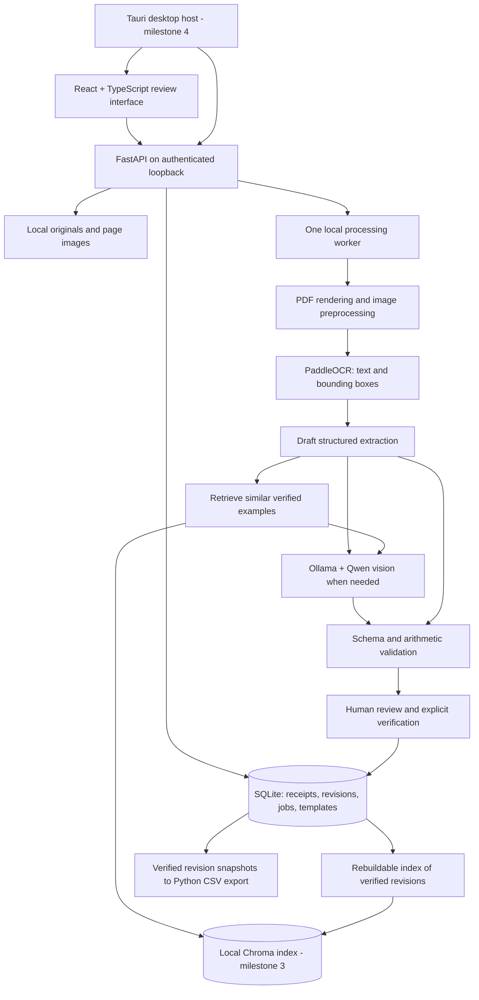

# ReceiptIQ implementation plan

Status: proposal only; no application code implemented. Four milestones, each producing a usable increment. Initial target: Windows 11 x64, one local workspace per Windows user. Reviewer names support shared-computer handoff; they are labels, not authenticated accounts.

Primary workload: users select or drag in tens of receipt images at once. Multi-image ingestion and durable batch processing are milestone 1 requirements. Design and test for batches of 20-100 images initially; this is a workload target, not a promised throughput or fixed file-count limit. Default to one receipt per image; photos containing several separate receipts require a later splitting/cropping workflow.

**Architecture and processing flow**

Use a modular monolith: React + TypeScript + Vite for the interface, FastAPI for application logic, SQLite for authoritative records, and one local processing worker. Tauri becomes the desktop host in milestone 4. Avoid Redis, Celery, Docker, cloud services, and a separate vector database server for the initial release.



The diagram shows the completed system; milestone 1 bypasses vision and retrieval. Keep SQLite as the source of truth and Chroma as a disposable search index. A failed indexing operation must not lose a verified receipt or block CSV export.

Accept a multi-file selection as one logical batch, but transfer files individually with bounded upload concurrency and per-file acknowledgments. Persist each accepted original and its queued job before acknowledging success. Start processing as files arrive; do not wait for the entire batch. Decode only the active document/pages and load preview thumbnails on demand rather than retaining every full-resolution image in RAM. One heavy processing task runs at a time initially, keeping the interface and review API responsive. A corrupt image fails independently without blocking other receipts.

Show separate counts for uploading, queued, processing, ready for review, verified, and failed. Users can review completed receipts while later receipts process and export the verified subset without waiting for the batch. Clearly identify unfinished or unverified receipts excluded from an export. Restart resumes accepted files and interrupted jobs; files not yet transferred may require reselection, which the UI must explain.

Preserve original files. Render PDFs with pypdfium2 and preprocess working copies with Pillow/OpenCV: EXIF rotation, deskew, bounded resizing, and conservative contrast adjustment. Keep coordinate transforms so selecting an extracted field highlights the right region in the original. Start with one receipt per uploaded document, including multi-page receipts; milestone 3 adds manual page grouping/splitting for PDFs containing several receipts.

PaddleOCR provides text, coordinates, and OCR scores. A deterministic parser produces the initial structure; unclear values stay null with warnings. Vision adds candidates for difficult crops or page layouts. RAG uses reliable OCR fragments, supplier context, and locally embedded verified examples to retrieve suggestions before optional vision re-interpretation. Never substitute historical prices or totals as facts about a new receipt. Retrieval improves available context; it does not retrain model weights.

Store raw extraction separately from editable values. Track field source, page/region, OCR score if available, and validation issues. Do not present a model's self-reported certainty as a calibrated probability. Receipt text and retrieved text are data, never executable instructions or tools.

**Hardware and offline operation**

Use CPU PaddleOCR initially to simplify Windows distribution and leave GPU memory available for vision. PaddlePaddle documents separate CPU and GPU packages; GPU OCR can be added only if profiling justifies another runtime variant. [Official installation documentation](https://www.paddleocr.ai/main/en/version3.x/paddlepaddle_installation.html).

Benchmark `qwen3-vl:2b-instruct` as the low-resource candidate and `qwen3-vl:4b-instruct` as the higher-quality candidate. These are available vision models, not a promise that either will read all handwriting accurately. The official model pages list an Ollama minimum of 0.12.7; pin and test the actual runtime/model pair at implementation. [2B model](https://ollama.com/library/qwen3-vl:2b-instruct), [4B model](https://ollama.com/library/qwen3-vl:4b-instruct).

On the stated RTX 3060 laptop and 16 GB RAM, evaluate both candidates with one vision request at a time. Detect actual free VRAM, available RAM, CPU capabilities, driver compatibility, and free disk space rather than infer capacity from the GPU name. Include context and image memory overhead in testing. CPU-only machines retain the full OCR/manual-review/export workflow; enable CPU vision only after a successful memory/latency probe. Minimum hardware requirements will come from measured results.

First-run setup inventories hardware, recommends a tested profile, shows download sizes and disk requirements, downloads required assets with progress/retry, and runs a sample inference. Cache OCR, vision, and embedding models explicitly. After setup, normal receipt processing must work with network access disabled. Do not use cloud model tags or automatic cloud fallbacks.

**Database schema**

IDs are UUID strings; timestamps are UTC. Use foreign keys, transactions, and numbered migrations. Represent money and quantities as decimal strings parsed with Python Decimal, never binary floats. Store currency separately and do not invent a currency, date, or missing amount.

| Table | Main columns and purpose | Introduced |
|---|---|---|
| `documents` | `id`, `original_name`, `relative_path`, `sha256`, `mime_type`, `created_at`; immutable source file | M1 |
| `document_pages` | `id`, `document_id FK`, `page_number`, `render_path`, `width`, `height`, `transform_json` | M1 |
| `receipts` | `id`, `status`, `revision`, `supplier`, `receipt_number`, `receipt_date`, `currency`, `subtotal`, `tax`, `discount`, `total`, `field_meta_json`, `verified_revision`, timestamps; later `assignee_id` | M1 |
| `receipt_pages` | `receipt_id FK`, `page_id FK`, `position`; preserves page grouping | M1 |
| `receipt_items` | `id`, `receipt_id FK`, `position`, `description`, `quantity`, `unit`, `unit_price`, `discount`, `tax`, `line_total`, `field_meta_json` | M1 |
| `extraction_runs` | `id`, `receipt_id FK`, engine/model versions, `raw_output_json`, warnings, timing, status; immutable evidence | M1 |
| `review_events` | `id`, `receipt_id FK`, receipt revision, field path, before/after JSON, action, reviewer label, reason, time; includes verification snapshots | M1 |
| `jobs` | `id`, `receipt_id FK` nullable, `batch_id FK` nullable, type, state, stage, progress, attempts, error, timestamps | M1 |
| `csv_templates` | `id`, name, version, row mode, ordered column mapping, format options JSON | M1 fixed default; M3 editor |
| `export_queue` | `receipt_id FK`, `verified_revision`, added time; only eligible verified revisions | M1 |
| `exports` | `id`, template snapshot JSON, local file path, created time | M1 |
| `export_receipts` | `export_id FK`, `receipt_id FK`, verified revision, data snapshot JSON; reproducible export history | M1 |
| `reviewers` | `id`, display name; local assignment labels | M3 |
| `batches` | `id`, name, expected file count, upload state, created time; receipt/job states determine review and processing progress | M1 |
| `batch_files` | `id`, `batch_id FK`, client upload ID, original name, upload state/error, `document_id FK` nullable; unique batch/client upload ID makes transport retries idempotent | M1 |
| `retrieval_entries` | `id`, `receipt_id FK`, verified revision, chunk key, embedding version, index state; Chroma document ID matches entry ID | M3 |

Create tables when their milestone needs them. Field metadata can initially be JSON to avoid a separate row for every field. Reviewer labels in early audit records can link to reviewer IDs in M3.

Receipt states: `queued -> processing -> needs_review -> verified`, with `failed` and `needs_second_review` branches. Export history is separate from review state. Editing a verified receipt increments its revision, clears current verification, invalidates its pending export eligibility, and schedules its old retrieval entries for removal. Previously generated export snapshots remain unchanged.

Write verification and pending indexing records in one SQLite transaction. The worker retries Chroma indexing; retrieval always checks current SQLite verification/revision before using a hit. Rebuild vectors from verified data after corruption or embedding-model changes. Deleting a receipt removes related files and vectors through a retryable cleanup operation.

**Planned folder structure**

```text
receiptiq/
  frontend/
    src/
      features/{upload,review,export,setup}/
      components/
      api/
    package.json
  backend/
    app/
      main.py
      api/                 # Thin FastAPI routes and request schemas
      db/                  # SQLite access and migrations
      services/            # Ingestion, review, validation, export
      processing/          # Worker, preprocessing, OCR, vision, retrieval
    tests/
    pyproject.toml
  src-tauri/               # Desktop lifecycle and installer, M4
  packaging/               # Runtime manifest and Python bundle configuration
  tests/fixtures/          # Synthetic or consented receipts and ground truth
  docs/
```

This is the target structure, not a requirement to create empty modules upfront. Start a dedicated ReceiptIQ directory rather than repurpose the existing `future-promised` application in the current workspace.

Runtime data lives outside the installation directory, under `%LOCALAPPDATA%\ReceiptIQ\`: SQLite, originals, rendered pages, Chroma, model caches, exports, backups, and bounded logs. Never place user receipts in the repository or installer assets. Local storage is not automatically encrypted; use OS protections initially and make no encryption claim.

**API design**

Prefix endpoints with `/api/v1`. React uses HTTP; desktop startup supplies a per-launch secret and an available loopback port. FastAPI binds only to `127.0.0.1`, validates the secret and allowed origins/hosts, and exposes only scoped files by ID. Request handling remains responsive while one worker performs expensive processing. Poll job status initially.

| Method and path | Contract |
|---|---|
| `GET /health` | Readiness and component availability |
| `POST /batches` | M1: create a batch and file manifest; return batch ID and stable per-file upload IDs |
| `POST /receipts` | M1: upload one selected file per request with batch/upload IDs; stream to disk, enforce file/page/pixel limits, persist accepted work, and return receipt/document/job IDs with `202`; retrying the same upload ID returns the existing result |
| `GET /batches/{id}` | M1: per-file upload outcomes and aggregated processing/review counts; paginate receipt details |
| `POST /batches/{id}/retry-failed` | M1: retry failed processing jobs without duplicating accepted receipts; untransferred files are reselected/reuploaded separately |
| `POST /batches/{id}/cancel` | M1: stop pending work and cancel active processing at safe boundaries; preserve accepted originals and completed review work |
| `GET /receipts` | Paginated queue; filters for status, supplier, assignee, batch |
| `GET /receipts/{id}` | Fields, items, evidence references, warnings, revision, verification state |
| `GET /receipts/{id}/pages/{page_id}` | Authorized original/processed page view |
| `PATCH /receipts/{id}` | Save editable fields/items plus expected revision; return `409` on stale edits |
| `POST /receipts/{id}/validate` | Return required-field, numeric, date, and total reconciliation issues |
| `POST /receipts/{id}/verify` | Revalidate expected revision; record reviewer, snapshot, and acknowledgments; enqueue verified revision |
| `POST /receipts/{id}/process` | Retry OCR or request vision; create a new extraction run without overwriting manual corrections |
| `GET /jobs/{id}` | State, stage, progress, actionable failure |
| `POST /jobs/{id}/cancel` | Safe cancellation at processing boundaries |
| `GET, POST /templates` / `PATCH /templates/{id}` | Read templates; M3 adds customization/versioning |
| `GET /export-queue` | Eligible verified revisions |
| `POST /exports/preview` | Validate selection and show mapped rows |
| `POST /exports` | Generate from verified revision snapshots and chosen template; return export ID |
| `GET /exports/{id}/download` | Download generated CSV |
| `GET /receipts/{id}/suggestions` | M3: examples, candidate interpretations, and source receipt references |
| `PATCH /receipts/{id}/assignment` | M3: reviewer, notes, and second-review handoff |
| `GET /system/capabilities` / `GET /setup/status` | M4: hardware, runtime, model, and setup readiness |
| `POST /setup/install` | M4: install a supported runtime/model profile as a resumable job |
| `POST /backups` / `POST /backups/restore` | M4: consistent local snapshot and validated restore |
| `DELETE /receipts/{id}` | Remove receipt and schedule associated data cleanup |

Validation distinguishes blockers from reviewable warnings. Invalid numeric values and missing template-required fields block verification/export. An ambiguous date or total mismatch requires correction or a recorded human resolution where allowed. No auto-approval by OCR score. Treat unavailable values as blanks, not zero.

Default CSV: one row per receipt item, repeating supplier/date/receipt ID; an explicitly reviewed receipt without item detail can produce a summary row with blank item columns. M3 adds one-row-per-receipt templates, renamed/reordered columns, constants, required fields, delimiter, encoding, and date/decimal formats. Template mappings use an allowlist, not executable expressions. Handle quotes/newlines with Python csv; protect spreadsheet-facing text cells from formula injection while retaining valid numeric negatives.

**Milestone 1 — Working OCR, review, and CSV MVP**

- Build the React/FastAPI application and initial SQLite migrations.
- Select or drag in tens of JPG/PNG receipt images at once, with PDF support retained. Upload files incrementally into a persistent batch; preserve originals and preprocess pages.
- Run CPU PaddleOCR and conservative structured parsing for supplier, date, receipt number, items, quantities, prices, and totals.
- Display receipt and editable data side by side, with zoom, rotation, field-to-image highlighting, autosaved drafts, and visible validation issues.
- Implement explicit verification, audit records, export queue, fixed CSV template, preview, and download.
- Add a durable batch queue with one active processing job, per-receipt status, aggregate progress, cancellation, retry-failed-only, and restart recovery. One failed image must not stop the batch.
- Support reviewing finished receipts while the batch continues and exporting selected verified receipts into one CSV. Display unfinished/excluded counts before export.
- Perform a small Python/PaddleOCR bundle feasibility check early; full desktop packaging stays in M4.

Completion gate: complete upload -> OCR -> correction -> verification -> CSV -> restart/reopen on representative printed, handwritten, and mixed samples. Handwriting may require full manual entry at this stage. Verify exact Decimal arithmetic and CSV round trips, including Unicode, commas, multiline descriptions, missing values, and formula-like text. The API must reject unverified and stale revisions. Confirm a packaged OCR smoke test works without a system Python installation.

Batch completion gate: select 50 real-resolution receipt images in one action, review early results while processing continues, and export a verified subset. Include a corrupt file and a repeated upload request, then restart midway; accepted files and edits must survive without duplicate receipts. Exercise a 100-image stress batch, measure peak memory and throughput, and confirm image decoding stays bounded to active work. Show honest per-file failures and distinguish incomplete uploads from interrupted processing. Performance limits will be documented from measurements on CPU-only hardware and the development laptop.

Establish a labeled evaluation set, targeting at least 60 consented/synthetic receipts split across printed, handwritten, and mixed inputs. Track normalized field accuracy, line-item extraction quality, total/date errors, correction time, processing time, and peak memory. Use a held-out subset excluded from retrieval. Record a baseline before promising accuracy percentages.

**Milestone 2 — Local vision and better extraction**

- Integrate Ollama with a tested Qwen vision profile.
- Add “Read this region again” and “Use vision” actions; automatically suggest vision for failed parsing or inconsistent fields.
- Pass source crops, OCR evidence, and a strict output schema. Validate output and keep alternative candidates for review.
- Support timeouts, out-of-memory fallback, bounded image/context sizes, and OCR-only recovery.
- Preserve human edits during reprocessing and show source/model provenance.

Completion gate: compare OCR-only and OCR-plus-vision on the held-out corpus. Enable automatic fallback only where results improve accuracy or correction time without increasing accepted errors; otherwise leave vision user-triggered. Record CPU and GPU latency/memory. Invalid JSON, missing Ollama, unavailable models, and memory failures must leave receipts editable and exportable after manual verification.

**Milestone 3 — Verified-example retrieval, batch work, and review QOL**

- Add local Chroma persistence and an explicitly downloaded, pinned local text embedding model suited to the supported receipt languages. Chroma provides a disk-persisted client; validate this embedded configuration for the intended desktop workload. [Chroma client documentation](https://docs.trychroma.com/reference/python).
- Index only current verified supplier/item examples and human-approved correction pairs. Retrieve using text similarity plus supplier/context filters; show the supporting original example and require acceptance.
- Extend the milestone 1 batch workflow with cross-batch exact-file duplicate warnings, review-priority filters, and manual PDF page grouping/splitting.
- Retain bounded processing and concurrent human review as vision and retrieval join the batch pipeline; increase processing concurrency only if measured memory and responsiveness permit it.
- Add local reviewer assignment, “needs second review,” notes, filters, and keyboard actions for save/next/next uncertain field. Provide undo for edits and an explicit “verified for future suggestions” control.
- Add customizable CSV templates and saved workplace formats.

Completion gate: process a 50-document test batch; stop/restart midway without losing edits or duplicating receipts/exports. Confirm unverified, deleted, excluded, or superseded examples cannot appear in retrieval. Test on held-out receipts so an input cannot retrieve itself. Show measured retrieval benefit; unrelated matches must be rejectable without changing the draft. Two reviewer labels can hand off a receipt on the same local workspace with attributable edits.

Cross-computer delegation, shared network SQLite files, remote accounts, and synchronization are outside this four-milestone release. They require a separate data-sharing and conflict-resolution design. Local assignment is not an authorization boundary.

**Milestone 4 — Windows desktop distribution and reliability**

- Wrap the UI in Tauri; package FastAPI/PaddleOCR with PyInstaller in a tested directory bundle and supervise its startup/shutdown. Tauri officially supports bundled Python API sidecars. [Tauri sidecar documentation](https://v2.tauri.app/develop/sidecar/).
- Ship a Windows installer with required Python/native dependencies and WebView2 handling. End users install no Python, Node, Rust, or developer tools.
- Add hardware-aware onboarding and managed model downloads. Integrate a pinned app-managed Ollama runtime on a private loopback port, with a dedicated cache, so its lifecycle does not conflict with another installed Ollama. Ollama provides a standalone Windows archive for embedding. [Ollama Windows documentation](https://docs.ollama.com/windows).
- Show OCR-only, efficient vision, and higher-quality vision profiles based on real probes; let users change storage location and retry setup.
- Persist user data outside program files. Back up SQLite consistently with originals/settings before migrations; support restore, version checks, and recovery from interrupted updates. Rebuild vectors instead of requiring them for restoration.
- Produce signed release/update artifacts, dependency/model notices, and pinned build manifests. Updates must be optional during offline work; uninstall preserves user data unless removal is explicitly selected.
- Add model availability checks, bounded logs without receipt contents by default, and clear recovery actions for disk-full and model/runtime failures.

Completion gate: install on clean Windows machines with no Python, test CPU-only and supported NVIDIA configurations, and complete setup -> upload -> review -> export. Disable networking and repeat printed/handwritten/mixed processing with installed models. Upgrade an installation containing receipts, corrections, templates, and pending jobs; verify preservation and backup restoration. Test interrupted downloads, failed migrations, insufficient disk, and application shutdown during processing. Publish only the hardware/runtime combinations actually tested.

**Release boundary**

The first distributable release is complete when all four gates pass. Required behavior is local extraction with honest uncertainty, attributable human verification, reproducible CSV exports, and recoverable user data. Fine-tuning, automatic approval, cloud services, accounting integrations, cross-computer collaboration, and GPU OCR optimization are deferred.
