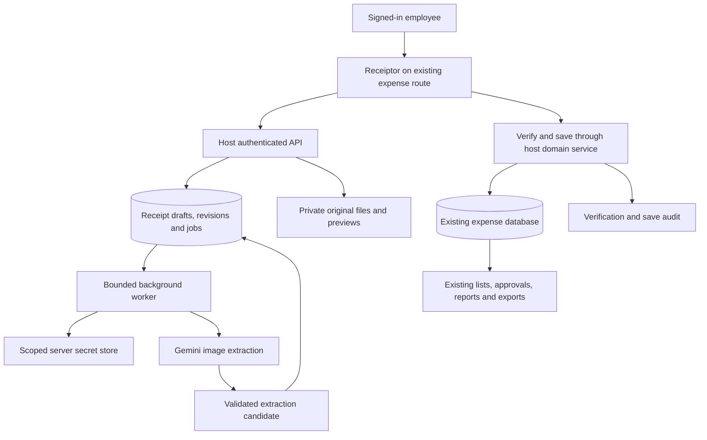

# Receiptor web integration plan

Date: 2026-10-30. Status: **design only; host project discovery pending**.

This plan replaces an existing website's receipt/expense input page with Receiptor. It does not replace the website's database, authentication, approval process, or export system. It is separate from the original four-milestone [PLAN.md](PLAN.md), which remains unchanged. Current standalone behavior is recorded in [CONTEXT.md](CONTEXT.md).

## 1. Intended outcome and working assumptions

An authorized employee opens the existing expense page, completes Gemini setup once, uploads receipts, reviews extracted fields, and verifies them. Verification automatically saves the human-verified receipt data into the existing expense database. The website's normal expense list, reports, approvals, and exports then use those records.

The host repository, stack, schema, authentication, and deployment environment have not yet been supplied. Consequently, endpoint names and storage entities below are proposed contracts, not descriptions of the host project. These assumptions must be resolved during discovery:

| Decision | Working assumption | What must be confirmed |
| --- | --- | --- |
| Entirely in the web | Browser UI using the website's authenticated backend; no desktop installation | Whether the user instead requires strictly browser-only execution |
| Key ownership | Each user enters their own approved key, matching the requested flow | Personal key versus one administrator-managed company key; choose one initial policy |
| Source of truth | Existing host expense database and domain services | Header/item structure, required fields, approval rules, edit restrictions |
| User identity | Existing login and organization membership | Upload, review, approve, credential administration, and deletion permissions |
| Automatic scanning | Gemini after explicit setup and cloud consent | Company policy, credential ownership, hosting region, operating budget |
| Last fallback | Hosted Qwen only if infrastructure is approved and available | Preserve Qwen on a server, or deliberately choose manual entry after Gemini failures |
| Existing data | Keep existing host records and standalone Receiptor data intact | Whether importing old standalone receipts is a separate desired task |

**Web deployment is a new target.** This plan does not switch the standalone desktop application away from its current local-first defaults.

Completion means a receipt can travel from upload to a verified host expense, with correct amounts and attachments, without duplicate creation, bypassing host permissions, or requiring Receiptor's CSV export.

## 2. Recommended architecture

Use the existing application as the main system. Integrate the review interface into its route and reuse its backend conventions, database, file storage, job facilities, logging, and deployment pipeline wherever suitable.

The browser uploads files and displays status. The backend owns authorization, validation, credentials, job scheduling, and expense writes. Background work continues after a user closes the page; opening the page again shows its durable state.

Google recommends a backend proxy for production web applications and a secure secret store for keys. Adopt that boundary here: the browser briefly holds a key while its owner enters it, but it never receives a stored key back. [Google API-key security guidance](https://ai.google.dev/gemini-api/docs/api-key#security-and-secret-management).

If the host is React, adapt the existing components to its router and shell. If it uses another frontend framework, first assess a supported React route/island versus porting the UI. Avoid a second login or an iframe that duplicates the entire standalone application.

If the backend is Python, reuse suitable extraction and validation modules directly. With another backend, compare a small private Python extraction worker against a focused port backed by shared contract fixtures. Keep the host's expense service responsible for business writes in either case. Do not introduce a new database or message broker merely to preserve the standalone directory structure.

Strictly browser-only execution would require revisiting durable jobs, secret custody, and the connection to the host database. It is not the recommended interpretation of this plan and cannot be promised without inspecting the host's existing APIs.

## 3. One-time setup tutorial

### Screen A: Welcome

Display the Receiptor wordmark with **tor** in its accent color, followed by:

> Hello! Welcome to Receiptor. Follow the steps below in order to use Gemini Vision.

Explain in ordinary language: Gemini reads uploaded receipt images and suggests values. The user still reviews and verifies them. Scanning uses the connected Google project's quota and may incur charges.

Offer **Set up Gemini**, **I already have an API key**, and **Continue with manual entry**. A missing key must not prevent permitted manual expense entry.

### Screen B: Get a Google API key

Present these steps in order, with links opening in another tab:

1. Sign in to [Google AI Studio](https://aistudio.google.com/) with a Google account approved for company work. If necessary, obtain an account through the company's administrator.
2. Complete Google's first-use terms and account prompts.
3. Open the dashboard's API Keys page. Use the approved project; new users may already have a default project and key.
4. If the existing project is missing, use **Dashboard → Projects → Import projects**, select it, and return to API Keys.
5. Create a key in that project, or select the approved existing key. Copy it and return to Receiptor.
6. If creation is unavailable, ask the project administrator for access.

Keep the tutorial tied to Google's current [key creation guide](https://ai.google.dev/gemini-api/docs/api-key#managing-api-keys-in-google-ai-studio). Do not ask for a Google password or imply that signing into the host website also signs into Google. Do not direct employees around company restrictions by creating an unapproved personal project. Include a short company-policy note linking to the requirements in section 4 before enabling real-receipt processing.

### Screen C: Connect and test

Show a password-style **Google AI Studio API key** field with an accessible reveal toggle and **Test connection** button. Trim accidental outer whitespace. Do not require an `AIza` prefix: the existing application supports newer dotted key formats, and the provider response is the authoritative connection test.

Before testing, explain: “This sends a small sample receipt image to Google and may use a small amount of API quota.” The sample is a fixed synthetic fixture with invented vendor and item data, never a real user receipt.

Proposed test sequence:

1. Send the entered key to the authenticated host backend over HTTPS; suppress request-body logging for this endpoint.
2. Call the primary model with the sample image, the actual extraction prompt, and the production response schema. A model-list request alone is insufficient.
3. Validate structured output and the fixture's required expected fields. Classify a valid-but-inaccurate extraction separately from authentication failure.
4. Return the tested model, result, and time, without returning the key or raw provider response.
5. On successful testing and the user's **Save and enable Gemini** action, securely store the credential and record explicit receipt-processing consent. A test alone does not enable automatic receipt uploads to Google.

Keep an unsaved key only in short-lived memory while this screen is open. Clear it after successful storage or leaving the flow. Never put it in localStorage, sessionStorage, URLs, analytics, or form-replay recordings. If server-side temporary storage is necessary between test and save, use an owner-bound, expiring secret reference; bind test success to that exact credential and configuration version.

| Test result | User-facing action |
| --- | --- |
| Primary vision test passed | “Gemini is ready.” Allow Save and enable Gemini |
| Credential rejected | Explain that the key was rejected; allow replacement |
| Access or project configuration denied | Show a safe permission/restriction message and administrator guidance |
| Quota or billing unavailable | Distinguish quota from malformed credentials; link to the project's Google usage/settings |
| Model unavailable | Identify the affected model; do not label the whole key invalid |
| Timeout or temporary provider error | Retry test; preserve the current form while open |
| Response schema/extraction test failed | Explain that connection worked but receipt extraction did not pass; retain manual entry |

The primary test must not silently fall back and then claim the primary model passed. Offer a separate bounded fallback check if needed, reporting each model independently. A passing test proves a working request at that time, not future quota, billing status, or perfect extraction.

### Screen D: Ready

Briefly demonstrate: **Upload → Review → Verify and save**. Explain that verification saves to the website and that its existing export page remains the place to export.

Persist tutorial version, completion time, consent version/time, and credential status on the server, scoped to the signed-in user and organization. Show it once per relevant account setup, not once per browser. Keep **Gemini settings** available for retesting, key replacement, disconnecting, and viewing setup help. Revoked keys should show a repair prompt rather than replaying the whole tutorial.

If the company chooses a shared key, only administrators perform credential setup; employees get the short usage introduction and appropriate disclosure. Do not build both ownership modes until the choice is confirmed.

## 4. Company data and credential policy

Google's terms permit professional/business use. They prohibit sending sensitive, confidential, or personal information through Unpaid Services. Gemini API Paid Services require a project linked to an active billing account; paid inputs and outputs are not used to improve Google's products, although limited safety/legal logging remains. Regional and age restrictions also apply. For actual company receipts containing such information, plan around a company-approved paid project and its data-processing requirements. [Gemini API terms, effective March 23, 2026](https://ai.google.dev/gemini-api/terms).

A working key cannot establish company authorization or whether the project satisfies these requirements. Have the organization owner confirm the applicable project and policy before real-receipt cloud processing. Do not advertise “free forever,” infer billing from a key prefix, or confuse a consumer Google AI subscription with API project billing.

Replace the current Windows DPAPI credential file with the host platform's managed secret storage or established encrypted-secret facility. Ordinary application records contain only an opaque secret reference, scope, version, status, and timestamps. Keys must remain outside receipt records, job payloads, exports, application backups, logs, error traces, and support screenshots. Secret-store disaster recovery is managed separately.

Enforce owner/organization authorization for test, save, replace, and delete operations. A company administrator can manage a shared key without a read-back endpoint. Rotation validates a replacement before activating it; disconnect prevents new calls and cancels queued calls using that credential. Record who changed the configuration, never its secret value.

Jobs carry credential references and versions. Define rotation semantics explicitly: pause or requeue eligible work against a tested replacement with an audit event; never silently use another employee's key. Offboarding must revoke access and settle or cancel pending work without losing already saved expenses.

## 5. Upload, scanning, and review flow

1. The user opens the existing expense route in the existing authenticated navigation.
2. They select files, drag and drop images, or use a supported mobile camera input. Start with existing supported formats; show unsupported files clearly.
3. Upload each file independently with bounded concurrency and a stable upload identifier. Acknowledgment means the original and draft/job references are durable. A repeated transfer must not create another draft.
4. Process accepted files while later files continue uploading. One corrupt file must not stop a batch. Preserve originals; generate previews separately.
5. Run the authorized vision policy in a background worker. Display queued, processing, ready for review, failed, and canceled states with the actual provider/model.
6. Apply extracted suggestions automatically only if the draft remains unverified and unchanged since that job's revision was captured. Otherwise retain a candidate the user can review explicitly.
7. Let the user edit receipt details, reorder/add/delete items, supply required host fields, and resolve field-linked issues while other receipts process.
8. **Verify and save** validates the current revision and writes through the host's expense service. Show the resulting expense link when saved.

Preserve Purchase date, Vendor, Receipt number, Receipt photo, Notes, Description, Quantity, Unit, Unit price, Amount, Type, and optional Photo of item purchased. Retain the current percentage-discount controls and row actions. Keep OCR and vision actions together below the preview where those capabilities exist in the hosted build.

Default to one receipt per image and an explicitly grouped document for a multi-page receipt. Flag images containing multiple separate receipts; do not silently invent splitting or merging. Establish PDF page/grouping rules and file limits during discovery.

Do not mark incomplete browser transfers as accepted uploads. Show unsaved changes and offer retry after connection loss. For the initial web release, avoid durable browser storage of receipt images or keys; users can resume server-accepted work from another device. Offline cloud scanning is unavailable.

## 6. Model policy and extraction safeguards

Retain the requested Gemini order: **`gemini-3.5-flash-lite` → `gemini-3.1-flash-lite` → `gemini-3.8-flash`**. Google's current model pages list image inputs and structured outputs for all three: [3.5 Flash-Lite](https://ai.google.dev/gemini-api/docs/models/gemini-3.5-flash-lite), [3.1 Flash-Lite](https://ai.google.dev/gemini-api/docs/models/gemini-3.1-flash-lite), [3.8 Flash](https://ai.google.dev/gemini-api/docs/models/gemini-3.8-flash). Availability must still be tested for the selected project and rechecked before launch.

The existing fourth step, local Qwen 2B, relies on a managed local Ollama runtime. An ordinary web page cannot inherit that runtime. Choose explicitly between:

- Hosting Qwen centrally, with measured memory/compute requirements, access controls, deployment ownership, and operating costs; or
- A first web release that ends with manual review/entry after Gemini failures. This is a proposed scope change requiring a decision, not a claim that the existing fourth fallback already works on the web.

Likewise, PaddleOCR must run on a server if retained. Do not ask end users to install Python, Ollama, or models. Treat hosted OCR as a separate deployment capability; do not show a working Run OCR button until it exists. Gemini image extraction should not depend on downloading a client-side model.

Pin allowed provider/model sequence, prompt/schema version, source revision, and credential reference when queuing. Manual scans continue to use the selected model. Give each receipt an overall processing deadline and bounded attempts across the whole sequence, including any row rechecks; avoid multiplying independent retries into an indefinite wait.

| Failure | Proposed hosted behavior |
| --- | --- |
| Timeout, transient 5xx, model-specific unavailability | Bounded retry/fallback, with per-step status and a total deadline |
| Invalid/revoked key or project permission failure | Stop cloud attempts; request credential repair |
| Rate limit | Respect retry timing and defer eligible work; distinguish model-specific from project-wide exhaustion |
| Exhausted project/billing budget | Pause affected cloud work; avoid trying every model repeatedly |
| Invalid/truncated extraction | Apply existing bounded recovery rules; visibly flag partial results or advance on unusable output |
| Cancellation or consent revocation | Stop subsequent attempts and discard late results that are no longer applicable |
| All permitted steps fail | Keep original and draft; offer manual entry and explicit retry |

Google rate limits are project-scoped, rather than independently reset by each key, and vary by model and tier. Share scheduling limits where the project association is known; use conservative per-credential/organization limits otherwise, without claiming global coordination across unknown projects. [Google rate-limit documentation](https://ai.google.dev/gemini-api/docs/rate-limits).

Keep the existing evidence, schema, arithmetic, row-audit, quantity-warning, and revision safeguards for Gemini. Stronger models still need the receipt contract. Treat receipt text as untrusted data, not instructions. Do not enable model tools, arbitrary URL fetching, or direct database writes. Preserve leading zeroes in receipt codes, source order with ` / ` separators, unknown values, and visible uncertainty. Model-reported row counts are a review aid, not proof of completeness.

Only current receipt images and permitted current OCR evidence go to Google. Do not include historical receipts or retrieval examples. Leave retrieval out of the initial hosted slice unless its organization isolation, opt-in, and retention policy are separately designed.

## 7. How verification becomes a host expense

Maintain separate concepts:

| Concept | Example states | Meaning |
| --- | --- | --- |
| Extraction | queued, processing, ready, failed, canceled | Whether receipt reading completed |
| Review | draft, needs review, verified revision | Whether a human accepted these exact values |
| Host save | not submitted, saving/pending, saved, failed, conflict | Whether the existing expense system accepted the revision |
| Financial approval | Existing host statuses | Manager/accounting approval, posting, reimbursement, or payment |

Verification must not bypass financial approval. A receipt can be verified and saved as an expense awaiting the website's normal approval workflow. The host contract decides that initial status.

### Preferred path: one backend and database transaction

On **Verify and save**:

1. Authenticate the user and check current organization membership and permission.
2. Load the current draft; compare its revision with the submitted revision and confirm uploads/processing no longer conflict.
3. Recompute monetary and required-field validation on the server. Require the existing warning acknowledgments and reason where applicable.
4. Resolve approved vendor/category/project references and ensure required attachments exist in durable private storage.
5. Within one database transaction, write the host expense header, ordered items, attachment references, source mapping, verified snapshot, and audit entry through the host's domain service.
6. Commit, then return the expense ID, accepted source revision, and host version. UI success follows this durable result.

Use a unique mapping from `(organization, source_receipt_id)` to the host expense, plus an idempotency record for each `(organization, source_receipt_id, verified_revision)` operation. Repeated clicks, a lost response, or retries return the same result. A later revision updates the existing mapped expense only when host rules permit it; it must not insert another expense. Concurrent edits use the host's version/conflict mechanism.

Confirm files before the database transaction references them. Since object storage and SQL generally do not share a transaction, stage files first and clean only proven unreferenced leftovers after a safe retention interval. A cleanup failure must not remove a referenced original.

### If separate services/databases are necessary

Atomically store the verified snapshot and a durable outbox operation in the receipt store. A worker submits that operation to an authenticated host API with the same idempotency key. The host atomically applies it and records the result; the worker then records the acknowledgment. Delivery can repeat, so both sides must tolerate it.

Show **Verified — waiting to save**, **Saved**, or **Save failed — retry** truthfully. Retries send the same immutable verified revision. Do not claim cross-service exactly-once delivery or use an untracked browser request as the only save mechanism. The existing exporter must only see committed host records.

If a pending verified receipt is reopened before delivery, cancel/supersede the pending operation only when its delivery state permits it. If delivery is uncertain, reconcile the host idempotency result first; do not create a second independent save. Later revisions must not overtake earlier unresolved operations.

### Changes after saving

Opening a saved receipt loads its mapped host record and version. Editing starts an unverified revision; the last committed expense remains authoritative until another authorized verification succeeds. Approved, paid, deleted, or closed-period expenses follow the host's amendment/reversal rules. A concurrent edit yields a conflict with reload/review options, never a silent overwrite.

Distinguish deleting an unsaved draft from voiding/deleting an expense. Keep the host's permissions, audit, retention, notifications, and financial side effects. Repeated integration delivery must not send duplicate approval notifications or repeat ledger/budget effects.

### Minimal API contracts

Use the host's routing and response conventions. These operations define responsibilities, not a requirement to add parallel endpoints where equivalents already exist:

| Operation | Required contract |
| --- | --- |
| Read setup status | Current user/organization scope, tutorial version, consent and safe credential status; no secret value |
| Test/configure/disconnect Gemini | Authenticated credential owner; bounded synthetic test; configuration version; safe result codes |
| Accept upload | Stable client upload ID; file validation; durable draft ID and upload acknowledgment |
| Read draft/job status | Authorized receipt data, revision, processing stage, actual model and safe failure code |
| Save draft edits | Expected revision and edited fields; return new revision and field issues; conflict on stale data |
| Request/cancel extraction | Allowed model, source revision and current consent; backend resolves credential and ownership |
| Verify and save | Expected draft revision, acknowledgment/reason and idempotency identity; return host expense ID/version or explicit pending/error state |
| Retry/reconcile save | Existing verified operation identity; no new expense identity and no unreviewed payload changes |
| Read original/preview | Authorized attachment lookup or short-lived private URL |

Return structured safe errors that distinguish authentication, permission, validation, conflict, quota, provider failure, and storage failure. Fetching status must not enqueue processing or repeat expense writes. Use existing polling facilities initially; add push updates only if the host already supports them or measured needs justify them.

## 8. Data mapping and money rules

Complete this mapping against the actual host schema before implementation. Reuse the host's existing create/update service rather than writing directly around its rules.

| Receiptor data | Host mapping requirement |
| --- | --- |
| Source receipt UUID and revision | Stable integration identity, unique mapping, accepted revision |
| Authenticated user and organization | Server-derived ownership; never trust submitted tenant IDs |
| Purchase date | Date-only value; avoid UTC conversion changing the calendar date |
| Vendor | Existing supplier ID or approved free-text behavior; no automatic vendor creation unless already supported |
| Receipt number | Text, preserving leading zeroes and joined codes |
| Currency | Host currency policy; do not assume all receipts share a currency or invent FX rates |
| Notes | Host text field with existing length/sanitization rules |
| Receipt photo/original | Private storage object and authorized attachment reference |
| Stable item ID, order, item number | Preserve editing identity and host ordering/numbering rules |
| Description, Quantity, Unit, Type | Required-field validation and explicit unit/category mappings |
| Unit price, Amount, Total | Discounted financial values using agreed decimal precision |
| Total/line discount percentages | Internal edit/audit metadata, not new export columns |
| Optional item photo | Host attachment capability or an approved extension |
| Project, cost center, budget, payment method, employee, etc. | Discover required host fields and provide actual user inputs/defaults authorized by host policy |
| Verification, acknowledgments, source model, versions | Immutable revision audit separated from provider credentials |

Current discount behavior remains:

- A blank line percentage inherits Total Discount (%). A manually entered line rate, including zero, wins. Clearing it restores inheritance.
- The editor retains gross unit prices. The host financial Unit price and Amount use discounted values, consistent with the user's chosen export behavior.
- Use exact decimal arithmetic. Current discounted unit prices support up to 12 decimal places; line amounts round half up to cents. The host's currency scale and rounding rules must be compared before adopting these unchanged.
- Do not silently round net unit prices to two decimals if that would make quantity times price disagree with the stored amount. If the host cannot represent the current precision, agree on a documented mapping before launch.
- Preserve gross prices, percentages, and override status in draft/revision metadata so reopening a receipt does not apply a discount twice.
- Require human acceptance of implicit discounts; do not manufacture allocations to force totals to match. Do not introduce Tax/Subtotal/legacy amount-discount controls into the UI.

For example, a gross unit price of 100 with quantity 2 and a 10% inherited discount becomes financial Unit price 90 and Amount 180. A line explicitly set to 0% retains its gross price even if the total percentage changes.

Use the host's duplicate checks plus organization-scoped exact-file fingerprints where useful. Flag likely duplicates for review; do not silently reject or merge different receipts merely because vendor, date, and amount match.

## 9. Existing exports and other page responsibilities

Remove Receiptor's CSV/ZIP download actions, export-template controls, and export-queue dependency from the integrated route. Keep the standalone application's historical CSV snapshots and export behavior intact. The website's current export is the only export workflow for the integrated product.

Verify the host exporter against newly saved receipts: selection, approval filters, ordering, currency, discounted Unit price/Amount, totals, optional photos, and text escaping must remain correct. Add no discount-percentage columns or hidden percentage notes. Keep existing host export columns unless a separate change is requested.

Inventory everything the old page does before replacing it: validation, defaults, vendor/category pickers, expense numbering, attachments, approval submission, project/budget effects, notifications, analytics, keyboard shortcuts, deep links, and edit/delete behavior. Preserve required behavior or document an explicit decision; a visual replacement must not drop business logic.

Keep the host shell, navigation, URL permissions, and visual conventions. Adapt the Receiptor wordmark and review interface within that shell. Test keyboard navigation, focus after row insertion/errors, screen-reader field labels, small screens, camera uploads, and independent preview/form scrolling.

## 10. Multi-user access and operational requirements

The current application has a local session token and reviewer labels. These are not hosted account authorization. Replace that boundary with the host login, role checks, session expiry, and CSRF protections where cookie authentication is used. Do not expose the local session-token endpoint publicly or merely remove its localhost check.

Enforce organization/record access on every draft, job, file, preview, key setting, verify operation, and expense link. Use private storage and short-lived authorized URLs if needed; guessing an ID must not reveal another user's receipt. Clear sensitive page state on logout/account switching. Key-test endpoints need rate limiting and must not become an unauthenticated proxy.

Validate upload type, size, page count, and decoded image dimensions. Bound PDF/image processing memory and temporary storage. Isolate risky document decoding according to the host's existing upload controls; do not render arbitrary uploaded HTML or model output as executable content. Restrict provider requests to approved destinations and models.

Use durable job state, lease/heartbeat recovery where multiple workers can run, and a single active extraction per receipt revision. Apply fair bounded scheduling across users/organizations. Refreshing or closing a tab must not restart an accepted job. Recheck authorization and consent before external calls and before applying results.

Keep logs focused on request/job IDs, safe error codes, model, latency, attempts, and usage counts. Avoid keys, images, full prompts, receipt contents, and raw provider responses. Business audit records may retain authorized receipt revisions separately under the company's access and retention rules. Configure host request tracing and error monitoring to redact sensitive payloads as well.

Establish operational ownership for provider outages, secret rotation, rejected saves, stalled jobs, storage growth, and model retirement. Track queue age, extraction success/failure, save failures, and usage attribution. Set app-side concurrency/usage limits as well as provider budgets; budget alerts alone are not an application hard stop. Agree on acceptable batch latency and availability after a staging benchmark rather than promising throughput now.

Confirm hosting supports background jobs, required runtime libraries, temporary disk, request limits, and deployment restarts. If the host uses short-lived serverless requests, dispatch extraction to its supported job service instead of keeping an HTTP request open for an entire batch.

## 11. Existing data, migration, and recovery

Back up host data and attachment references before schema changes; demonstrate restore in staging. Add compatible integration metadata/draft storage first. Existing expenses remain readable and editable through their normal paths. Do not automatically rerun AI over historical records.

Decide explicitly how existing expenses open in Receiptor: map their saved net values without inventing unknown gross prices or historical discounts, and keep their host IDs. Existing verified/approved status must not be fabricated from import assumptions. Check compatibility with the old page during rollout so it cannot erase new metadata or misinterpret discounted amounts.

Importing old standalone Receiptor workspaces is a separate optional migration. If requested, dry-run counts, attachments, IDs, money, and duplicates; preserve originals, revisions, and export snapshots. Windows-protected keys do not become portable web credentials; reconnect them through setup. Never copy the current local user workspace into a shared production tenant by default.

Define retention for abandoned drafts, failed uploads, originals, verified revisions, and audit records with the company. Do not choose arbitrary deletion periods for financial evidence. Keep application backup/restore and private object storage recovery consistent; restoring a database alone must not leave valid expenses with missing photos. Credentials are restored or re-entered through the separate secret-management process.

## 12. Implementation phases and exit criteria

| Phase | Work | Exit criterion |
| --- | --- | --- |
| 0. Host discovery and contract | Inspect repository, old page, auth, schema, exporter, jobs/storage, hosting and policy; resolve decisions in section 1 | Approved field/role/status mapping, key scope, fallback choice, and a concrete integration design |
| 1. Integrated manual workflow | Add route behind a feature flag; adapt review/editor, host auth, drafts, attachments, and money validation; implement Verify and save through host service | Manual synthetic receipt saves once with correct items/photos and appears correctly in existing exports |
| 2. Onboarding and credentials | Tutorial, secure key storage, real image test, consent, replacement/disconnect, status and error messages | Authorized user can complete setup; failed tests do not enable cloud scans or leak credentials |
| 3. Upload and extraction | Durable batch ingestion, background processing, Gemini order, selected manual scans, revision guards, agreed final fallback | Successful and failed batches recover after restarts; human edits survive late results |
| 4. Host workflow completion | Edit/reverify, conflicts, duplicate warnings, approval side effects, retry/reconciliation if outbox needed; remove integrated export actions | End-to-end flow preserves host business rules and remains safe after repeated/lost requests |
| 5. Validation and pilot | Security/tenant isolation, money, accessibility/mobile, representative permitted receipts, performance, backup/restore and rollback rehearsal | Acceptance matrix passes; remaining limitations documented and assigned |
| 6. Controlled cutover | Enable for a small authorized group, monitor, then replace the old route for the intended users | Stable pilot evidence, support owner, recovery procedures, and no unresolved blocking data errors |

Keep changes as reviewable completed slices with tests appropriate to the actual host stack. Reuse existing libraries and deployment services. Do not add Global RAG, accounting automation, a new exporter, or a generalized integration platform as part of this task.

## 13. Acceptance test matrix

| Area | Required proof |
| --- | --- |
| Setup | First-time/resumed tutorial, already-has-key route, manual skip, cross-device completion, organization switching |
| Credential security | No secret in returned payloads, browser persistence, logs, receipts, jobs, exports, or app backups; unauthorized users cannot manage another scope |
| Test accuracy | Actual synthetic image and production schema; invalid key, permission denial, quota, timeout, unavailable model, malformed output; no real expense created |
| Processing | Each fallback position, exhaustion, cancellation, disabled consent, late response, worker restart, bounded attempts, per-project throttling where known |
| Uploads | Partial transfer/retry, duplicate acknowledgment, corrupt/oversized document, multi-page input, missing required file, batch failure isolation |
| Human review | No auto-verification; processing cannot overwrite manual edits; stale revision rejected; warnings and reasons enforced server-side |
| Money | Inherited/manual/zero discounts, clearing overrides, new/reordered rows, high quantity warning, exact decimals and rounding, mismatch rejection, reopening without double discount |
| Host persistence | Repeated Verify, parallel clicks, lost response after commit, database failure, attachment failure, same-revision retry, changed host version, later verified revision |
| Approval integration | Correct initial status; no verification bypass; locked/paid/deleted records follow host rules; no duplicate notifications or ledger effects |
| Authorization | Cross-user and cross-organization attempts against every receipt/file/job/key/save route; expired session, removed membership, offboarding |
| Exports | Existing columns and filters unchanged; net prices and amounts correct; no percentage columns/notes; optional photos and formula-like text handled safely |
| Recovery | Restore records plus files; credentials remain separate; retry/reconcile pending saves; rollback with queued work and already saved expenses |
| UX and load | Supported browsers, keyboard and screen-reader flows, narrow/mobile layout, camera input, sign-out cleanup, tens of receipts while review remains usable |

Use deterministic synthetic fixtures and mocked provider failures for most tests. Add a small controlled live Gemini smoke test in staging to prove the actual transport/model/schema combination. Production key testing is user-initiated and uses synthetic content. Real-receipt evaluation uses only company-permitted samples and an authorized data policy.

## 14. Rollout and rollback

Deploy additive schema/storage changes before activating the new route. Feature-flag the page per organization or pilot group, and keep the previous page available until the pilot meets acceptance criteria. Avoid concurrent independent edits through both interfaces to the same expense without version checks.

On rollback, stop new ingestion/verification through Receiptor, prevent new cloud calls if relevant, and reconcile already accepted verification operations before redirecting users. Restore the previous page while keeping all saved host expenses and integration audit records. Do not delete financial rows to simulate rollback, and do not blindly replay pending writes through the old page.

Retain the compatible additive schema during rollback. Reversing a schema change or restoring a pre-migration database is a separate recovery action requiring preservation and reconciliation of later writes. Document operators, commands, backups, expected counts, and checks before production cutover.

## 15. Current source map for implementation

These paths locate reusable behavior; they do not imply the files can be deployed unchanged to the web.

| Current file | Role in the integration |
| --- | --- |
| [frontend/src/Review.tsx](frontend/src/Review.tsx) | Receipt editor, preview, row controls, discount inputs, autosave and review actions |
| [frontend/src/ReceiptAssistance.tsx](frontend/src/ReceiptAssistance.tsx) | Vision model selection, suggestions and manual scan controls |
| [frontend/src/WorkspaceSettings.tsx](frontend/src/WorkspaceSettings.tsx) | Existing provider/key UX to replace with hosted onboarding/settings |
| [frontend/src/App.tsx](frontend/src/App.tsx), [frontend/src/api.ts](frontend/src/api.ts) | Separate standalone shell/export/local session assumptions from host integration |
| [backend/app/models.py](backend/app/models.py), [backend/app/extraction.py](backend/app/extraction.py) | Receipt contracts, validation and exact monetary behavior |
| [backend/app/service.py](backend/app/service.py) | Current edit/verify logic; replace export-queue side effect with the host save contract in the integrated target |
| [backend/app/google_vision.py](backend/app/google_vision.py), [backend/app/vision.py](backend/app/vision.py) | Provider adapter, shared extraction safeguards, structured output and candidate handling |
| [backend/app/vision_settings.py](backend/app/vision_settings.py), [backend/app/worker.py](backend/app/worker.py) | Pinned upload sequence, processing state and revision protection; adapt for hosted ownership/jobs |
| [backend/app/google_key.py](backend/app/google_key.py) | Windows secret protection to replace with hosted secret storage |
| [backend/app/main.py](backend/app/main.py), [backend/app/db.py](backend/app/db.py) | Local-only API/session/workspace/database assumptions that must not become public auth/storage |
| [backend/app/imaging.py](backend/app/imaging.py), [backend/app/system.py](backend/app/system.py) | Distinguish reusable preprocessing from local runtime/download management |

Tauri packaging, local folder selection, model installation dialogs, workspace relocation, standalone backup controls, and CSV templates do not belong on the integrated end-user page. Replace any required operations with the host's administration process.

## 16. Information needed to turn this into an implementation task

The first three answers establish the design boundary:

1. **Host project:** local path or repository URL; existing expense route; frontend/backend stack, database and hosting if known.
2. **Web requirement:** browser UI with the website's backend, or strictly browser-only processing.
3. **Key ownership:** employee-supplied key, administrator-managed company key, or a justified need for both.

Then inspect or request:

- Expense/header/item schema, create/update API or service, required fields, sanitized example records, export headers and a representative export fixture.
- Existing roles and approval rules; whether verified receipts should enter draft/submitted/approved state, and who can edit, delete, or reopen them.
- File storage, attachment linking, current retention/backup policy, permitted data regions, and the company's Google project/data policy.
- Currency/rounding rules, quantities/units/categories, vendor matching, project/cost-center fields, and duplicate handling.
- Typical batch size, concurrent users, daily volume, acceptable wait, and operating budget.
- Whether server-hosted OCR/Qwen is required, and whether previous standalone receipts need migration.

The repository itself can answer many of these. Do not require the user to manually transcribe information that can be inspected once access is provided. Estimate effort and choose exact migrations only after that inspection. Until then, this document is the detailed implementation blueprint, with unresolved decisions clearly identified.
